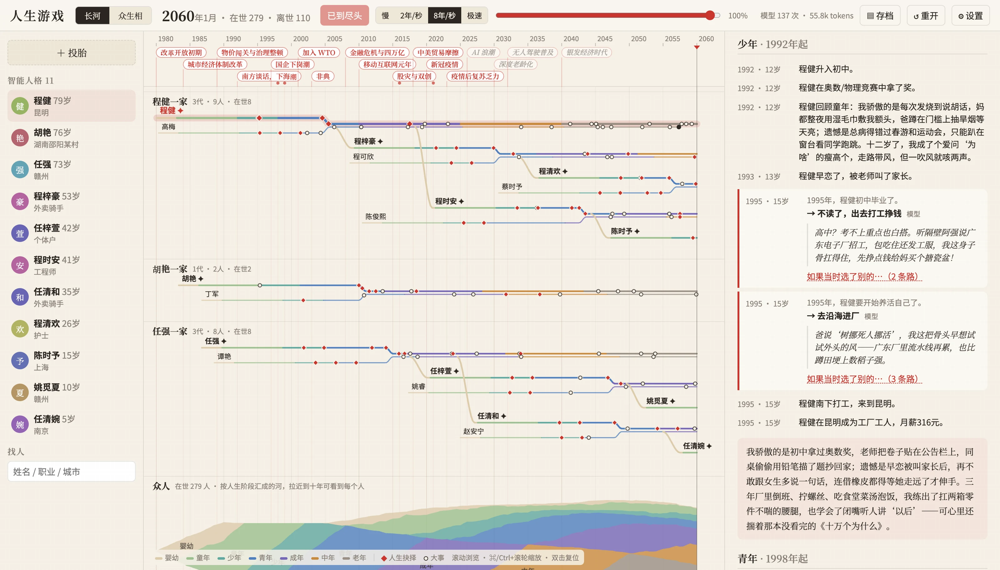
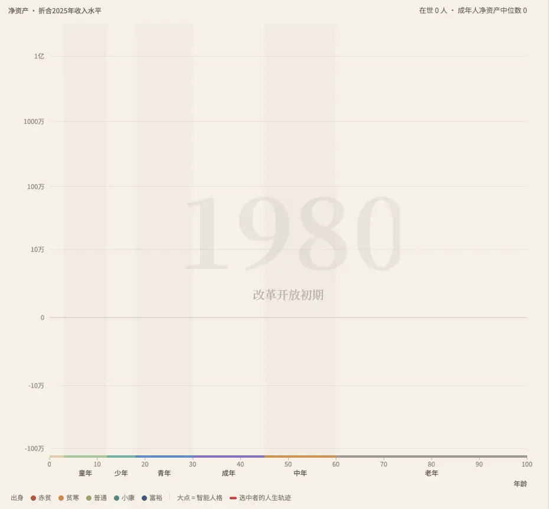
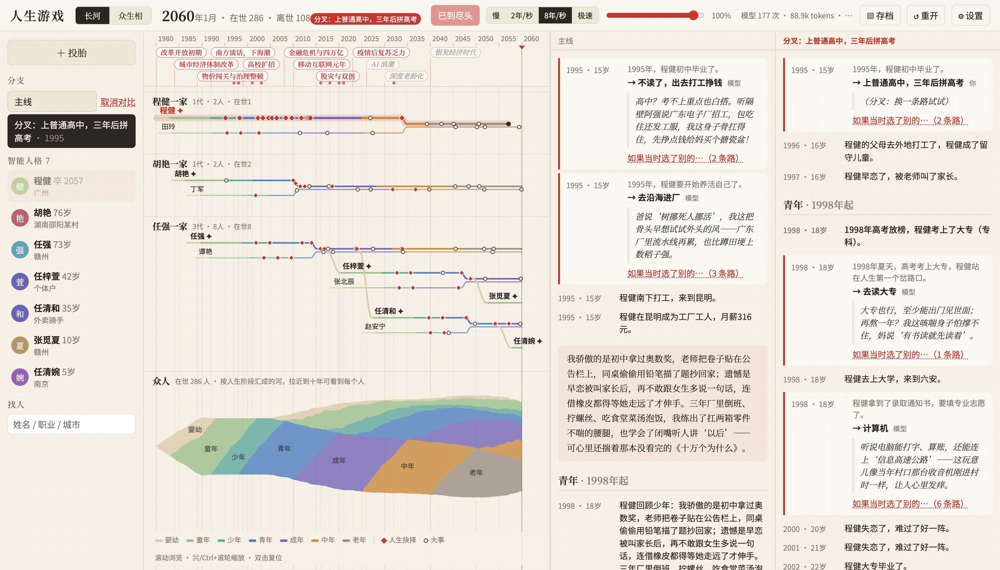
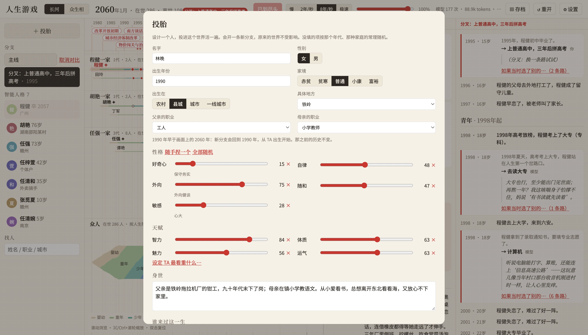

# 人生游戏 · LifeGame

一个"每个生命都有真正智能"的生命游戏：几百个 bot 共处一个映射真实历史的世界，出生、读书、高考、择业、婚育、买房、下岗、退休、老去。规则引擎跑日常，大模型只在人生节点出场——以这个人的人格、处境和记忆做抉择，并留下一句内心独白。你可以旁观，可以接管任何一个人的人生，也可以在任何一个抉择处分叉出平行人生并排对比。

<p align="center"></p>
<p align="center"><sub>长河：三个家族八十年的人生轨迹，红色菱形是人生抉择。右边是程健的人生卷轴：1995 年初中毕业，模型以他的人格决定不读了、出去打工，并写下当时的念头。</sub></p>

## 截图

<p align="center"></p>
<p align="center"><sub>众生相：从 1980 年播到 2060 年。横轴年龄，纵轴净资产（对数刻度，折合 2025 年收入水平），颜色是出身，红线是程健的一生。</sub></p>

<p align="center"></p>
<p align="center"><sub>如果当时选了别的：在程健 15 岁那次抉择上分叉。主线里他去昆明进厂；分叉里他读了高中、考上大专、学了计算机，一心想去中关村，婚事一推再推，53 岁才成家。</sub></p>

<p align="center"></p>
<p align="center"><sub>投胎：设计一个人。1990 年生在铁岭，父亲是工人，母亲教小学，再写几句身世，让模型以 TA 的人格活一遍，或者由你替 TA 做每个决定。</sub></p>

<p align="center"><sub>截图里的独白与反思由 <code>qwen3-vl-plus</code> 生成。</sub></p>

## 快速开始

```bash
pnpm install
pnpm dev          # http://localhost:5180
pnpm cli -- --pop=200 --seed=42 --idx=3   # 无界面跑一个世界并打印第 3 个人的一生
pnpm test
```

## 模型

在「设置 → 智能 → 模型服务」里选一家、填密钥、选模型，点「测试」就知道能不能用。预置了二十来家 OpenAI 兼容的服务：

| 分组 | 服务 |
|---|---|
| 免费 | LLM7（不注册、不填密钥就能用） |
| 国内 | DeepSeek、硅基流动、智谱 GLM、阿里云百炼、月之暗面 Kimi、火山方舟、腾讯混元、百度千帆、阶跃星辰、MiniMax、AIHubMix |
| 海外 | OpenRouter、OpenAI、Google Gemini、Anthropic、Groq、Cerebras、Mistral、xAI |
| 本地 | Ollama、LM Studio，以及任意自定义的 OpenAI 兼容地址 |

填了密钥会向 `/models` 拉这把密钥实际能用的模型；预置的模型名只是推荐，也可以直接填。不少服务有免费的模型或额度（硅基流动的 Qwen3-8B、智谱的 GLM Flash、混元 lite、OpenRouter 带 `:free` 的模型、Gemini、Groq、Cerebras 的免费额度），设置里每家都写了。

**没有设置时自动挑**，顺序是：

1. 你在设置里选定的；
2. 你填了密钥的服务；
3. 部署站点提供的服务（部署方放在环境变量里的密钥，见下文）；
4. 免密钥的免费服务 LLM7（开局先探一下能不能连上）；
5. 都没有：纯规则运行，开局会提示。

LLM7 匿名使用每人同时只能发 1 个请求，每天有 token 上限。额度用完时只提示一次，之后的人生节点按各人性格决定，世界不会卡住；在设置里填一个密钥并保存，画面之后的节点会用新模型重做，不用重开世界。

**密钥去哪儿了**：密钥只存在你的浏览器（localStorage）里。允许网页跨域调用的服务由浏览器直接请求，不经过任何服务器；智谱、腾讯混元、Anthropic 不允许，经本站的 `/api/llm/<服务>` 转发（只转发到预置地址，不记录）。

**开发时**：`pnpm dev` 会把本机环境变量里的密钥（`DEEPSEEK_API_KEY`、`OPENROUTER_API_KEY`、`AIHUBMIX_API_KEY` 等，变量名见 `packages/llm/src/presets.ts` 的 `envKey`）当作"站点提供"的服务，标着"本机密钥"。密钥留在 Node 侧，浏览器经 `/api/llm/site/<服务>` 访问，代理只接受同源请求。

```bash
pnpm cli:live -- --model=deepseek/deepseek-flash --seed=42             # 用真模型活一条人生，打印独白与反思
pnpm cli:live -- --model=llm7/mistral-Nemo-Instruct-2407 --heroes=1    # 免密钥的免费模型
pnpm cli:live -- --heroes=12 --leads=3 --speed=2 --level=1 --quiet     # 压力测试：模拟 2 年/秒的画面，统计可见停顿
```

## 部署到 Vercel

仓库根目录的 `vercel.json` 已经配好：用 pnpm 安装，构建 `apps/web`，静态页面加一个函数 `api/llm.ts`（模型代理，和开发服务器共用 `packages/llm/src/proxy.ts`）。

1. 在 Vercel 导入这个仓库，Root Directory 保持仓库根目录，其余用默认（框架选 Other，构建命令和输出目录会从 `vercel.json` 读）。
2. 不配任何环境变量也能用：访客没填密钥时用免费的 LLM7，连不上就按规则。
3. 想让访客不填密钥就用你的模型，在 Project → Settings → Environment Variables 里加对应的密钥，比如 `DEEPSEEK_API_KEY`、`SILICONFLOW_API_KEY`、`ZHIPU_API_KEY`。默认放行 `/models` 拉到的全部模型；加 `DEEPSEEK_MODELS=deepseek-flash` 这样的变量只放行列出的几个。注意这相当于请访客用你的额度，站点公开时最好只放免费或便宜的模型。

本地验证部署产物：`npx vercel build`（需要先 `vercel link`，或手写 `.vercel/project.json`），产物在 `.vercel/output`。

## 玩法

- **长河**：顶部是历史事件轨道。主角和你选中的人所在的家族各占一块，每人一条线，颜色是人生阶段；婚后两条线并成一股，孩子从母亲的线上分出，红色菱形是人生抉择，墨点是离世。其余的人按人生阶段汇成一条河，拉近到十年左右会展开成每个人各一条线。滚动浏览，⌘/Ctrl+滚轮缩放，双击复位，点击任何一条线打开卷轴。
- **众生相**：Gapminder 式气泡图。横轴年龄，纵轴净资产，按工资水平折算到 2025 年并用对数刻度，颜色是出身。播放时整代人从左下往右上流动；选中的人会拖出一条人生轨迹。
- 拖动顶部进度条可以回看任意年份，两个视图都会还原到那一年。
- **人生卷轴**：按阶段分章的一生。红边卡片是人生节点，有模型的内心独白；每章末尾是模型以第一人称写的阶段反思。
- **赋予智能**：任何人都可以随时开启；主角的子女自动继承。
- **我来掌控**：开启后，这个人每到人生节点都会停下来，由你来选，或者"让 TA 自己决定"。
- **投胎**：侧栏「＋ 投胎」设计一个人：名字、性别、出生年份和地方、家境、父母职业、性格与天赋、最看重什么，再写几句身世（模型做决定时会读到）。可以让模型以这个人格去活，也可以自己替 TA 做每个决定，或者按规则活。投胎会开一条新分支：出生在画面之前，世界回到那一年从 TA 出生开始，那之前的历史不变；出生在之后，就从此刻开始等 TA 出生。
- **存档**：顶栏「存档」可以保存、读取、删除、导出成 JSON 文件和导入。存档只记种子、智能设定的时间线和画面之前每个人生节点的答案，读档时世界从头重放到存档那一刻，不调用模型，通常不到一秒。每 10 秒自动存档一次，刷新页面会自动回到上次的世界；「重开」才会开一个新世界。
- **如果当时选了别的…**：在任何一个历史抉择上分叉。引擎从该年快照出发回放到那一刻，换一个选择，重跑另一条人生。新分支和原分支并排对比，分叉前的内容淡显。

## 架构

```
packages/schema   zod/TS 类型：Bot、WorldEvent、DecisionNode、WorldState
packages/core     确定性引擎：xoshiro128** RNG、tick 循环、事件日志、年快照、分叉回放
packages/eras     时代包（当前：当代中国 1980–2060）：出生/人格、阶段钩子、决策、随机事件、历史时间线
packages/llm      模型适配层：OpenAI 兼容 provider、预置服务、选模型、代理、提示词、结构化解析、缓存与用量
apps/web          React + PixiJS；引擎与模型调用跑在 Web Worker
apps/cli          无界面批量运行
api/llm.ts        Vercel 函数：模型代理
```

## 时代怎样作用于个人

历史事件除了调整整体的招聘景气和裁员率，还通过每个职业随年代变化的"需求"和"工资"曲线落到具体的人身上（`packages/eras/src/china-modern/data.ts` 的 `JOB_TRENDS`）：需求决定找到这份工作的机会和被裁的风险，工资是相对全国工资指数的倍数。下岗潮压垮国企，入世让工厂缺人，移动互联网抬高程序员；2026 年以后（推演）AI 接手写代码、做设计、记账、写稿，机器人进工厂，无人车上路，老龄化让护士和养老护理员最缺人。萎缩行业的失业会写明原因，人物处境里也会告诉模型"这一行在萎缩"。

体检工具：`pnpm --filter @lifegame/cli jobs -- --seeds=6` 按十年统计各职业的入职人数和相对工资。改了影响世界走向的规则，要给时代包的 `rulesVersion` 加一，旧存档读取时会提示。

## 模型调用怎样不卡住世界

- **犹豫期**：智能角色提出决策后，提示词当场定下并发出请求，世界照常运转；答案在犹豫期结束（婚事三个月、买房两个月等）那个月生效。
- **推测执行**：到期了答案还没回来，就先按这个人最可能的选择往下走，真答案回来再纠正：退回那一刻重放。别人的答案只在提示词指纹完全相同时才复用，所以最终的世界和一个个老实等出来的世界逐字相同（有测试保证）。
- **局部性**：每个人一条独立的随机数流，决策编号按"本人:第几个"、孩子编号按"母亲.第几个"生成，婚配抽签按"我和你"派生随机数。改选一个人的决定，其余 95% 以上的人生逐字不变，所以纠正时别人的答案大多能复用。
- **画面只播到第一个未确认的主角推测之前**，用户永远看不到会被撤回的内容。模拟领先画面约 12 秒的播放量，有推测时最多跑过第一个推测 10 年。
- **主角与配角**：主角（开局选中的和你手动赋予智能的）的推测挡画面；配角（继承了智能的子女）的推测不挡，答案赶在画面到达之前回来就纠正，赶不上就算"凭直觉"。
- **阶段反思、心愿、子女继承智能都经由引擎生效**，有自己的到期时间，所以同样可重放。
- **调度**：每个服务限并发（默认 4），主角优先、同级按到期先后；429 和超时退避重试。取消只是"不再等"，不中断已发出的连接：Node 自带 fetch 在 HTTP/2 上中断在途请求会卡死进程。

压力测试（`aihubmix/qwen3-vl-plus`，12 个智能人格开局、子女继承后约 40 个，其中 3 个主角，2 年/秒播放，理想 40 秒）：

| 方案 | 总耗时 | 可见停顿 | 单次最长 |
|---|---|---|---|
| 谁想都让世界停 | 346 秒 | 几乎一直在等 | — |
| 犹豫期 + 主角/配角分级 | 55 秒 | 20 秒 | 2.6 秒 |
| 加推测执行 | 48 秒 | 5.8 秒 | 0.9 秒 |

剩下的上限是吞吐量：8 个并发、单次约 2.8 秒，每秒最多答约 3 个；智能人格越多，配角"凭直觉"的比例越高。

关键约束：

- 同一种子 + 同样的非规则决策 = 完全相同的世界（有测试保证）。模型的选择记入事件日志，回放不重新花钱。
- 决策分"答复"和"落地"两步：驱动层随时可以对 `world.pending` 调用 `resolveDecision` 给出答案，引擎在 `dueTick` 按提出顺序落地。`step()` 遇到到期未答复的决策时不前进，返回 `blocked`。
- 模型带来的一切状态变化（选择、独白、心愿、反思）都必须经由引擎节点落地，不能在引擎外异步改写人物，否则重放会对不上。命运旁白只用于展示，不进提示词。
- 提示词只能读已经生效的状态。还在犹豫期里的答案早到晚到取决于网络，读了它世界就会随网速变化（测试"批量运行可重放"会抓到）。
- 驱动层统一用 `packages/llm/src/director.ts`（网页 Worker 和 CLI 共用），不要另写一套。
- 模拟领先画面十几年，界面上的人物状态必须按画面所在时刻取（store 的 `yearBots` 与 `World.botAt`），不能直接用模拟最新的状态，否则会剧透。
- 投胎进来的人记在 `state.births` 里，由引擎在出生那个月用 `era.createCustomBot` 创建（只能用 `ctx.keyedRng`）。
- 智能设定（谁由模型驱动、哪个模型、是不是主角）记在 `state.intelChanges` 时间线里，重放时在原来的那个月生效；不要直接改 `bot.intelligence`，用 `World.setIntelligence`。存档读档靠 `exportAnswers` 和 `World.replay`。
- 一条人生约 20~60 次模型调用。档位 0 纯规则、1 只在节点、2 加阶段反思与命运旁白。

## 下一步

- 第二个时代包（唐朝 / 中世纪西欧）验证时代抽象
- 世界地图与关系图，按时代切换画风
- 人与人的关系：同学、同事、朋友、仇人；智能人格之间的对话
- Anthropic 官方 SDK、每个 bot 独立配模型的界面
- CLI 批量实验与统计、导出单人卷轴
